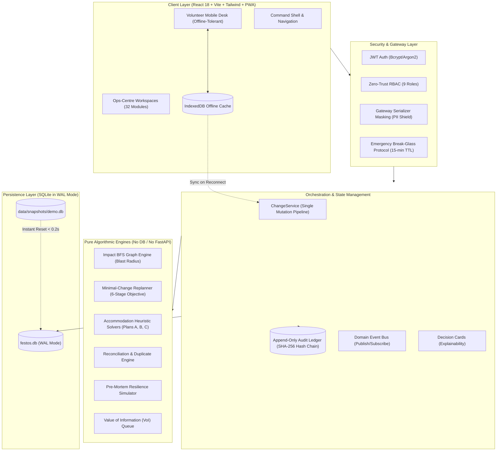

# FestOS — Festival Operating System & Command Centre

> **Festival:** Aarohan (EPINOIA 2026, IIM Indore)  
> **Core Principle:** **AI proposes. Deterministic logic validates. Humans approve.**  
> FestOS is a mission-critical command cockpit designed to orchestrate collegiate festival operations at scale, managing 2,836 participants, 38 contingents, 31 events, 9 venues, 14 food vendors, and 1,450 beds across town.

---

## 1. What is FestOS?

FestOS is **not** a registration portal or a simple CRUD database. It is the central operational intelligence layer for fest organizers, designed around the reality that in live festival operations, **a single disruption cascades across accommodation, transport, food, and stage schedules**.

```text
Any Change or Disruption ---> Blast Radius Impact Tree ---> Ranked Recovery Plans ---> Human Approval ---> Atomic Execution ---> Verification Pass
```

### Core Tenets
1. **Never Force Numbers:** We refuse to artificially force the 2,400 prospectus estimate. FestOS ingests 2,836 raw participant rows, accounts for 2,842 declared strength, and transparently reconciles the 426 unexplained remainder for committee review.
2. **UNKNOWN is a First-Class Value:** A blank field never defaults to vegetarian, male, or absence of special accommodation needs. It is tracked as `UNKNOWN` and prioritized on the **Unknowns Burn-Down Queue**.
3. **Hard Constraints Never Auto-Relax:** Safety, privacy, accessibility, and minor protection rules are strictly enforced. Soft constraints (cohesion, cost, proximity) are relaxed only with a recorded operational rationale.
4. **Explainable AI Boundary:** AI assists in code generation, command interpretation, and draft communications. Deterministic engines enforce all rules. Humans approve all state changes.

---

## 2. Architecture & System Flow



---

## 3. 32-Module Operational Directory

FestOS coordinates all festival operations through 32 modular services, each exposing a strict read-only public contract (`public.py` with `summary`, `risks`, and `dependents`):

| Domain | Modules & Slugs | Key Responsibilities & Capabilities |
|---|---|---|
| **Governance & Security** | `auth`, `audit`, `approvals`, `overrides` | JWT tokens, lockout defenses, immutable SHA-256 hash chains, override registers, and 9-role access matrix. |
| **Rosters & Data Quality** | `imports`, `assumptions`, `participants`, `contingents`, `reconciliation`, `unknowns` | Tolerant CSV ingestion, live parameter catalog, Golden Headcount Waterfall, reversible merges, and VoI ranker. |
| **Accommodation & Check-in** | `accommodation`, `checkin` | Heuristic Plans A/B/C, 200 campus rooms (710 beds), 6 external hotels (740 beds), corridor safety, and QR check-in desks. |
| **Stages & Competition** | `events`, `venues`, `schedule` | 31 festival competitions, 9 venues, 10-conflict scheduling engine, advancement ratios, and equipment requirements. |
| **Physical Operations** | `logistics`, `merchandise`, `vendors`, `food`, `staff`, `transport`, `finance` | Central Store inventory, QR single-claim anti-fraud ledger, 14 food vendors, dietary matrix, volunteer shifts, and settlements. |
| **Operational Intelligence** | `incidents`, `impact`, `scenarios`, `premortem`, `forecasting` | 7 live disruption drills, multi-chain BFS blast radius graph, what-if sandboxes, resilience simulator, and crowd forecasting. |
| **Executive & Reporting** | `dashboard`, `commands`, `decisions`, `reports` | Attention Queue, natural-language command workspace, Decision Cards, and exportable compliance reports. |

---

## 4. Test Credentials Table

FestOS provisions accounts across all nine operational roles (from [`docs/TEST_CREDENTIALS.md`](docs/TEST_CREDENTIALS.md)):

| Role | Name | Email | Password | Primary Scope / Capabilities |
|---|---|---|---|---|
| **`FESTIVAL_DIRECTOR`** | Festival Director | `director@festos.internal` | `FestOSDirector2026!` | Command cockpit, policy overrides, high-risk approval signing |
| **`ACCOMMODATION_LEAD`** | Accommodation Lead | `accommodation@festos.internal` | `FestOSAccommodation2026!` | Hostel blocks, commercial hotels, room allocation, bed turnover |
| **`EVENT_LEAD`** | Event Lead | `events@festos.internal` | `FestOSEvents2026!` | Competitions, heat schedules, venue assignments, judge slots |
| **`LOGISTICS_MANAGER`** | Logistics Manager | `logistics@festos.internal` | `FestOSLogistics2026!` | Central Store equipment, stage AV assets, vehicle movements |
| **`MERCHANDISE_MANAGER`** | Merchandise Manager | `merch@festos.internal` | `FestOSMerch2026!` | Kit inventory, T-shirt sizing ledger, distribution counters |
| **`FOOD_OPS_MANAGER`** | Food Operations Lead | `food@festos.internal` | `FestOSFood2026!` | Food vendor compliance, meal slots, dietary allergen coverage |
| **`FINANCE_MANAGER`** | Finance Manager | `finance@festos.internal` | `FestOSFinance2026!` | Hotel and vendor settlements, disputes, emergency procurement |
| **`VOLUNTEER`** | Volunteer Gate 1 | `volunteer@festos.internal` | `FestOSVolunteer2026!` | Isolated mobile view: check-in scanning & merchandise issuance |
| **`AUDITOR`** | Compliance Auditor | `auditor@festos.internal` | `FestOSAuditor2026!` | Read-only compliance audit trail, hash-chain verification |

---

## 5. Quickstart & Setup Guide

### 5.1 Prerequisites
- Python 3.11+
- Node.js 20+ and npm
- (Optional) Docker & Docker Compose

### 5.2 Local Installation
```bash
# 1. Clone repository
git clone https://github.com/Krishnaa-21/festos.git
cd festos

# 2. Configure environment
cp .env.example .env

# 3. Install backend dependencies
python3 -m pip install -r backend/requirements.txt

# 4. Install frontend dependencies
cd frontend && npm install && cd ..

# 5. Initialize & seed the database (or restore instant demo snapshot)
python3 scripts/backup_restore.py restore data/snapshots/demo.db

# 6. Start the API server (Terminal 1)
cd backend && python3 -m uvicorn app.main:app --reload --host 0.0.0.0 --port 8000

# 7. Start the Web UI (Terminal 2)
cd frontend && npm run dev
```

- **Web Application:** [http://localhost:5173](http://localhost:5173)  
- **API Swagger Documentation:** [http://localhost:8000/docs](http://localhost:8000/docs)  
- **API ReDoc Index:** [http://localhost:8000/redoc](http://localhost:8000/redoc)

### 5.3 Docker Compose
```bash
# Build and launch production containers
docker compose up --build -d

# Verify services
docker compose ps
curl http://localhost:8000/health
```

---

## 6. How to Reset the Demo

During rehearsals or live judge demonstrations, return the system to the known pristine baseline instantly:

```bash
# Instant snapshot restore (< 0.2 seconds):
python3 scripts/backup_restore.py restore data/snapshots/demo.db

# Or full clean seed rebuild from raw CSVs (~25 seconds):
python3 -m app.seed reset
```

---

## 7. How to Run Tests & Verification Harnesses

FestOS provides an extensive verification suite ensuring 100% ground-truth accuracy:

```bash
# 1. Verify Ground-Truth Claims against Live System (Task 5)
python3 scripts/verify_claims.py

# 2. Run Pre-Demo Health & Disruption Scenario Check (< 60s benchmark)
python3 scripts/pre_demo_check.py

# 3. Run Full 32-Module Smoke Test & Live Disruption Drills
python3 scripts/smoke_all.py

# 4. Run Cross-Module Public Contract & Architectural Consistency
python3 scripts/check_cross_module_consistency.py

# 5. Run Backend Unit & Property Tests (Pytest)
PYTHONPATH=backend pytest -v backend/tests

# 6. Run Frontend Component & Accessibility Tests (Vitest)
cd frontend && npm run test && cd ..

# 7. Generate Submission Sample Plans & Reports
python3 scripts/generate_sample_plans.py
```

---

## 8. Repository Folder Guide

```text
festos/
├── backend/                  # FastAPI Modular Monolith
│   ├── app/
│   │   ├── api/v1/           # 32 auto-discovered API routers
│   │   ├── core/             # RBAC, audit, masking, ChangeService, clock
│   │   ├── engines/          # Pure algorithmic solvers (impact, replan, accom)
│   │   ├── models/           # SQLModel domain models (canonical tables)
│   │   ├── schemas/          # Pydantic request/response validation schemas
│   │   ├── seed/             # Database initialization & raw CSV seeders
│   │   └── services/         # Business logic & read-only public.py contracts
│   ├── festos.db             # SQLite WAL database (gitignored)
│   └── tests/                # 224 backend tests across all modules
├── data/
│   ├── golden/               # Verified golden outputs
│   ├── raw/                  # 11 source CSV files from festival pack
│   └── snapshots/demo.db     # Verified pristine demo snapshot
├── docs/                     # Comprehensive engineering specifications
│   ├── AI_DISCLOSURE.md      # AI slide content & 3-column governance matrix
│   ├── API.md                # Complete 240-operation REST API index
│   ├── ASSUMPTIONS.md        # Authoritative 43-key assumption catalog
│   ├── LIMITATIONS.md        # Explicit disclosure of technical compromises
│   ├── PRIVACY_AND_SECURITY.md # DPDP compliance, masking & audit ledger
│   ├── PITCH.md              # 7-minute pitch outline & 3-minute Q&A defense
│   ├── TEST_CREDENTIALS.md   # System login credentials for all 9 roles
│   └── spec/                 # Master FestOS functional specification
├── frontend/                 # React 18 + Vite + TypeScript Client
│   ├── src/
│   │   ├── components/       # Shared UI library & AppShell navigation
│   │   ├── features/         # 32 modular workspace pages
│   │   ├── pwa/              # Offline Dexie.js cache & sync engine
│   │   └── types/generated.ts# Types generated from OpenAPI
├── scripts/                  # Operational harnesses & CI tools
│   ├── backup_restore.py     # SQLite snapshot & restore utility
│   ├── generate_sample_plans.py # Generates Deliverable 02 plans
│   ├── pre_demo_check.py     # Automated pre-demo rehearsal harness
│   ├── smoke_all.py          # 32-module smoke suite & disruption drills
│   └── verify_claims.py      # Automated number & citation verification
└── submission/               # Competition submission package
    ├── deck/                 # Slide deck & fallback recording guide
    └── sample_plans/         # Sample accommodation (A/B/C), schedule & inventory
```

---

## 9. Deliverables Cross-Reference Index

| Deliverable | Location in Repository | Verification Method |
|---|---|---|
| **Working Portal** | `http://localhost:5173` | Run `make dev-web` or Docker Compose |
| **Sample Plans (A, B, C, Schedule, Inventory)** | [`submission/sample_plans/`](submission/sample_plans/) | `python3 scripts/generate_sample_plans.py` |
| **Reconciliation & Quality Reports** | [`submission/sample_plans/`](submission/sample_plans/) | Generated CSVs & `verify_claims.py` |
| **Setup & Run Instructions** | Section 5 of this `README.md` | Run local setup or Docker |
| **Test Credentials Table** | Section 4 of this `README.md` & [`docs/TEST_CREDENTIALS.md`](docs/TEST_CREDENTIALS.md) | Verified in `pre_demo_check.py` |
| **Assumptions Register** | [`docs/ASSUMPTIONS.md`](docs/ASSUMPTIONS.md) | Generated from live DB `assumption` table |
| **Limitations Disclosure** | [`docs/LIMITATIONS.md`](docs/LIMITATIONS.md) | Itemized technical compromises |
| **AI Disclosure & 3-Column Slide** | [`docs/AI_DISCLOSURE.md`](docs/AI_DISCLOSURE.md) | 3-column matrix & pitch slide |
| **Privacy, Security & DPDP** | [`docs/PRIVACY_AND_SECURITY.md`](docs/PRIVACY_AND_SECURITY.md) | Masking & SHA-256 audit ledger |
| **API Index** | [`docs/API.md`](docs/API.md) | Generated from OpenAPI (240 operations) |
| **Claims Ground-Truth Verification** | [`scripts/verify_claims.py`](scripts/verify_claims.py) | Run `python3 scripts/verify_claims.py` |
